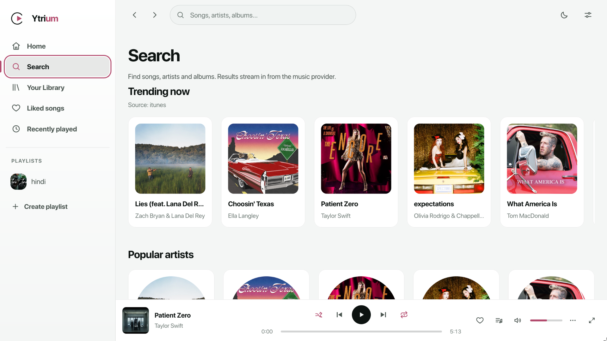

<p align="center">
  
</p>

<h1 align="center">Ytrium</h1>

<p align="center">
  <b>Your music, searched, queued and played — a local-first desktop player.</b><br/>
  Built with Rust + Tauri 2 and React. No account, no server, no telemetry.
</p>

<p align="center">
  <a href="https://github.com/vivek-502/ytrium/releases/latest"></a>
  
  
  <a href="LICENSE"></a>
</p>

---

Ytrium is a single-window desktop music player that keeps everything on your machine. Search the
web for music, queue it, organise it into playlists, and play it back with a full-screen player
and synced lyrics. One process, one window, no listening port, no account — the UI talks to a
Rust core over IPC, and audio is decoded and played natively, not by a browser engine.

Ytrium is an original project: its own name, mark, and colour system. It is not affiliated with,
derived from, or a clone of any existing streaming service. Looking for the browser/self-hosted
build with local user accounts? That is [ytrium-web](https://github.com/vivek-502/ytrium-web).

<p align="center">
  
</p>

## Highlights

- 🔎 **Discovery** — full-text search with recent-search history, home sections (trending,
  popular, new releases, recommended for you, quick picks), and artist and album pages with
  related artists. Charts come from Apple's public iTunes RSS.
- 📚 **Library** — liked songs, playlists (create, rename, edit, delete, drag-and-drop
  reordering), saved albums, followed artists, recently played grouped by day, and per-track
  play signals that feed recommendations.
- 🎧 **Real player** — play/pause, next/previous, seek bar, volume and mute, shuffle, repeat
  (off → all → one), a queue you can reorder, one-tap retry on stream errors, autoplay and
  cross-track fades. Audio is decoded in Rust (`symphonia`) and played through `rodio`.
- 🎤 **Synced lyrics** — the full player follows along with the track, falling back to plain
  text, with graceful *instrumental* / *no lyrics* states. Lyrics come from the public LRCLIB
  API, with the track's own captions as a fallback.
- 🎨 **Interface** — mini player bar + expandable full player with a blurred artwork backdrop,
  a toggleable lyrics panel, a slide-in queue, context menus, toasts, skeleton loaders, light/
  dark theme with five accent colours, compact mode and reduced motion.
- ⚙️ **Settings** — theme, accent, autoplay, crossfade length, audio quality (auto/low/high),
  volume normalisation, clearing listening data, and JSON export **and import** of everything.
- ⌨️ **Keyboard** — Space, ←/→ (Shift for 10s), ↑/↓, `M`, `N`/`P`, `S`, `R`, `Q`, `F`, `/`, `?`, `Esc`.
- 🔒 **Fully local** — no account, no telemetry, no open port. Your library lives in the app's
  own storage on this machine; nothing but provider calls leaves it.

---

## Install

### Linux (any distro)

One command — works on Debian, Ubuntu, Fedora, Arch and everything in between. It installs for
your user, no root:

```bash
curl -fsSL https://raw.githubusercontent.com/vivek-502/ytrium/master/scripts/install.sh | bash
```

It checks your architecture and the WebKitGTK 4.1 runtime, tells you exactly what's missing if
anything is, then installs:

- `~/.local/bin/ytrium` — the app
- a start-menu entry ("Ytrium") in your app menu

Let it install the provider tools too (`yt-dlp` + `ffmpeg` via your package manager), pin a
version, or remove it again:

```bash
curl -fsSL https://raw.githubusercontent.com/vivek-502/ytrium/master/scripts/install.sh | bash -s -- --with-deps
curl -fsSL https://raw.githubusercontent.com/vivek-502/ytrium/master/scripts/install.sh | bash -s -- v1.0.0
curl -fsSL https://raw.githubusercontent.com/vivek-502/ytrium/master/scripts/install.sh | bash -s -- --uninstall
```

Prefer a real package? The release also carries a **Debian package** (`Ytrium_<version>_amd64.deb`)
for Debian/Ubuntu/Mint, and [`packaging/arch/PKGBUILD`](packaging/arch/PKGBUILD) builds it on Arch:

```bash
sudo apt install ./Ytrium_1.0.0_amd64.deb        # Debian / Ubuntu
cp packaging/arch/PKGBUILD . && makepkg -si      # Arch
```

### Windows

Download **`Ytrium_1.0.0_x64-setup.exe`** from the [latest release](https://github.com/vivek-502/ytrium/releases/latest)
and run it. Windows may show a SmartScreen warning because the installer is not code-signed yet:
*More info* → *Run anyway*.

### Portable (Linux)

Grab **`ytrium-linux-x64.tar.gz`** from the [latest release](https://github.com/vivek-502/ytrium/releases/latest):

```bash
tar -xzf ytrium-linux-x64.tar.gz
cd ytrium-linux-x64
./install-desktop-entry.sh          # optional: add it to your app menu
./ytrium
```

The tarball contains the binary, the app icon, an example `ytrium.desktop` entry and that helper,
so nothing needs an installer or root.

### Every install needs `yt-dlp`

Ytrium does not download or ship media itself: it drives [`yt-dlp`](https://github.com/yt-dlp/yt-dlp)
to find and resolve tracks, exactly like the web build does. **`ffmpeg` is recommended** (used by
`yt-dlp` when a format has to be remuxed).

| Platform | Command |
| -------- | ------- |
| Arch | `sudo pacman -S yt-dlp ffmpeg` |
| Debian/Ubuntu | `sudo apt install yt-dlp ffmpeg` (or the [up-to-date binary](https://github.com/yt-dlp/yt-dlp#installation)) |
| Fedora | `sudo dnf install yt-dlp ffmpeg` |
| Windows | `winget install yt-dlp.yt-dlp ffmpeg` |

If Ytrium cannot find `yt-dlp`, playback fails with a clear *provider* error — update it
(`yt-dlp -U`) whenever searches or playback suddenly stop working.

## Build from source

Prerequisites:

- **Rust** (stable, 1.80+) — [rustup.rs](https://rustup.rs)
- **Node.js 20+** and npm
- Linux only, the Tauri system deps ([full list](https://tauri.app/start/prerequisites/)):
  `sudo apt install libwebkit2gtk-4.1-dev build-essential curl wget file libssl-dev libgtk-3-dev libayatana-appindicator3-dev librsvg2-dev`
- Windows only: Visual Studio Build Tools with the "Desktop development with C++" workload
- `yt-dlp` on `PATH` (`ffmpeg` recommended) to actually search and play

```bash
git clone https://github.com/vivek-502/ytrium.git
cd ytrium
npm install

npm run app:dev            # Vite on :5173 + the Tauri window (hot reload)
npm run app:build          # installers + binary in src-tauri/target/release/
```

Useful variants:

```bash
npm run typecheck                                  # TypeScript
cargo clippy --all-targets                         # from src-tauri/
cargo tauri build --no-bundle                      # just the release binary
bash packaging/make-portable.sh                    # ytrium-linux-<arch>.tar.gz
bash packaging/arch/make-arch-pkg.sh               # Arch package (needs base-devel)
```

### Scripts

| Command | What it does |
| ------- | ------------ |
| `npm run app:dev` | Vite dev server + the Tauri window |
| `npm run app:build` | Type-check, build the UI, then bundle the app |
| `npm run build` | Type-check + build the UI only |
| `npm run typecheck` | `tsc --noEmit` |
| `npm run tauri` | Raw Tauri CLI |

---

## Architecture

```
src/                          React UI
  components/                 UI kit, menus, dialogs, cards, track lists, player, layout
  pages/                      Route-level screens (code-split)
  stores/                     Zustand: player, library, settings, ui, discovery, lyrics
  engine/audioEngine.ts       Drives the Rust audio engine over Tauri IPC
  providers/                  MusicProvider interface + apiProvider (talks to Rust)
  rec/                        Local recommendation engine over your play signals
  lib/                        IndexedDB, preferences, formatting, hooks
  styles/                     tokens / base / layout / components / player

src-tauri/src/                Rust core
  lib.rs                      Window setup + command registration
  api.rs                      The whole `/api/*` surface in process, exposed as `api_request`
  providers/                  youtube (yt-dlp), charts (iTunes RSS/lookup), lyrics (LRCLIB)
  audio/                      rodio + symphonia engine: range reader, normaliser, mixer sink
  ytdlp.rs, http.rs           Process + HTTP plumbing (ureq), timeouts, user agents
  cache.rs, config.rs, error.rs
  devcheck.rs                 Network/decode integration tests
```

The UI never opens a socket. Every provider call goes out through the Rust side, and every
`/api/*` path the frontend already knew (`/api/search`, `/api/charts`, `/api/lyrics`, …) is
answered by [`src-tauri/src/api.rs`](src-tauri/src/api.rs) inside the process, so the frontend's
provider layer is identical to the web build's.

**Player internals** — an audio thread owns the `rodio` output sink and a player, a loader thread
resolves the media URL and appends the decoded stream, and a seek worker owns the player handle.
The UI polls `audio_status` (~250 ms) and derives play/pause/waiting/ended/error from state
transitions, so there are no event listeners to leak. Media is streamed into memory through a
`RangeReader`; a stale resolved URL is invalidated and re-resolved automatically.

### Where your data lives

| What | Where |
| ---- | ----- |
| Library, playlists, history, queue | IndexedDB (`ytrium-web`) in the app's data directory |
| Preferences (theme, accent, volumes, …) | `localStorage` for the same origin |
| Caches (search, metadata, charts, lyrics, stream URLs) | In memory in Rust, TTL based — never written to disk |
| App data directory | Linux `~/.local/share/com.ytrium.desktop` · Windows `%APPDATA%\com.ytrium.desktop` |

Expiring media URLs are never persisted, and nothing but provider API calls leaves the machine.
Use **Settings → Your data** to export or re-import everything as JSON.

### Provider integration boundary

- **Search, metadata and streaming via `yt-dlp`** — spawned by Rust with an argument array (no
  shell interpolation), `--force-ipv4`, a 30 s hard timeout, and in-memory TTL caches.
- **Charts/album/artist discovery via Apple's public iTunes RSS + lookup endpoints** — metadata
  only; those records are resolved to a playable source on demand.
- **Lyrics via the public LRCLIB API** (exact match, then a scored search), with the track's own
  captions as a fallback. Fetched only when you open the lyrics panel; cached in memory.

Out of scope by design: streaming from iTunes or any other commercial catalogue, cloud sync, a
central catalogue, DRM playback and telemetry. If a provider call fails (network down, rate
limited, region blocked) the UI shows a retryable error state rather than a broken control.

---

## Troubleshooting

| Symptom | Fix |
| ------- | --- |
| Playback fails with a provider error | Check `yt-dlp --version`, then update: `yt-dlp -U` |
| Searches fail with a provider error | Same: Ytrium drives `yt-dlp`, so a stale one breaks search first |
| Search and playback time out after ~30 s | Almost always a broken IPv6 route — Ytrium already forces IPv4 for `yt-dlp`; check `curl -6 -sI https://www.youtube.com/` (a hang means IPv6 is unusable) |
| Audio never starts | The engine opens the default output device lazily on first play — make sure one exists (`pactl info`, or Windows sound settings) |
| The window is blank on Linux | The WebKitGTK 4.1 runtime is missing: `sudo apt install libwebkit2gtk-4.1-0` (Fedora: `webkit2gtk4.1`, Arch: `webkit2gtk-4.1`) |
| Slow first stream | The first request resolves the media URL (~1–3 s); it is cached afterwards |
| Empty charts | iTunes may be unreachable or rate limited — restart the app to clear the in-memory cache |
| No menu entry after a portable install | Run `./install-desktop-entry.sh`, and make sure `~/.local/bin` is on your `PATH` |
| Windows SmartScreen warning | Expected until the installer is code-signed: *More info* → *Run anyway* |

## Contributing

Bug reports and pull requests are welcome — see [CONTRIBUTING.md](CONTRIBUTING.md). Releases are
built by [`.github/workflows/release.yml`](.github/workflows/release.yml) on every `v*` tag.

## License

[MIT](LICENSE) — provided as-is for personal use. Ytrium ships no media and hosts nothing:
playback is driven by `yt-dlp` against the providers you point it at, and lyrics are rendered for
personal use only.
